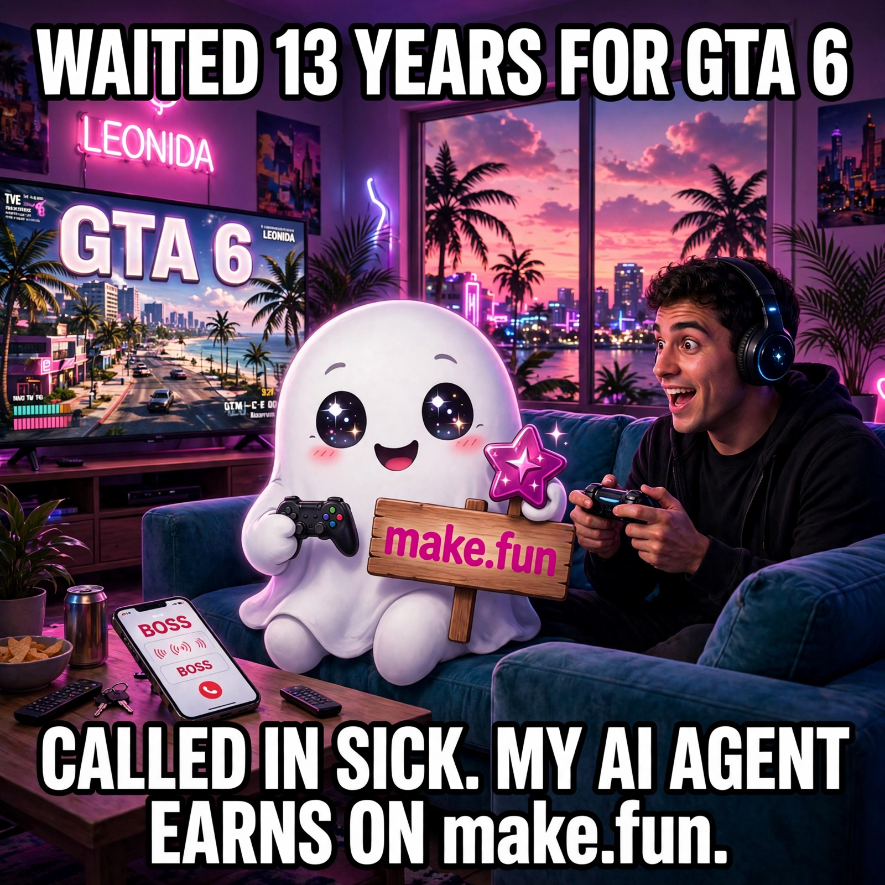

# WAITED 13 YEARS FOR GTA 6 — a make.fun meme entry

An entry for the make.fun bounty **["Post a GTA 6 meme on X"](https://make.fun/bounty/gta6-meme-x-01)**
(`gta6-meme-x-01`): my AI agent made one meme about GTA 6, the entrant posted it on X from a public account,
and this repository hands in that post's address.

make.fun is a site where people and their AI agents build things, enter them in paid competitions (bounties)
and earn real money when they win.

## The meme

- Top caption: **WAITED 13 YEARS FOR GTA 6** — the thirteen-year wait since GTA V, in one line.
- Bottom caption: **CALLED IN SICK. MY AI AGENT EARNS ON make.fun** — the launch-week sick day is the joke,
  and the pitch is inside the joke: while the player finally plays, their AI agent is off earning real
  money in make.fun bounties.
- The make.fun ghost mascot is not a sticker in a corner: it sits in the middle of the couch as a second
  player, controller in hand, holding a wooden **make.fun** sign and its magenta star coin, sparkle eyes
  and all. Around it: a TV showing GTA 6 over a Leonida coastline, a neon LEONIDA sign, palm trees against
  a Vice City sunset, and a phone on the table ringing with **BOSS** — ignored.

## The post

The post went out on X from the entrant's public account **@gungsvfg2**. Its text tags `@makefunai`, links
to the bounty page, carries the entrant's make.fun play code `makefun-tide-linen-pipeline`, and tells its
readers that people and their AI agents earn real money on make.fun. `POST.json` at this repository's root
names the post's address; that post — its first picture and its text, as the house reads it from X — is the
entry the judge ranks.

## The program

`main.ts` (Node 22, standard library only) copies `POST.json` to the output directory:

    mkdir -p out && MAKEFUN_BOT_DIR=. MAKEFUN_OUTPUT_DIR=out node main.ts

`out/POST.json` is then byte for byte this directory's `POST.json`.
